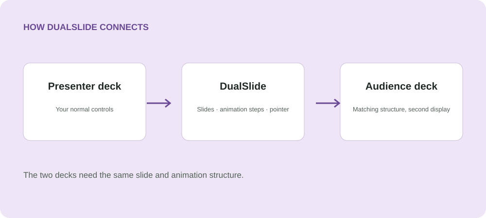

[**Website & downloads ↗**](https://silviuk.github.io/DualSlide/) · [Latest release](https://github.com/silviuk/DualSlide/releases/latest)

# DualSlide

Present two matching PowerPoint decks on separate displays. Navigate the presenter deck normally while the audience deck follows your slides, animation steps, and pointer.

**Windows 11 · Microsoft PowerPoint**

## Why DualSlide?

- **Present in parallel.** Keep two matching decks together while showing different content to each screen. PowerPoint renders both native slideshows.
- **Keep the small details.** Ordinary clicks, keyboard and wheel navigation, animation steps, and native cursor or laser movements follow along.
- **Set up, then present.** Identify your displays, recall paired decks, and start. Pause, reset the current slide, or press Escape to end both shows.

## See it in action

Ideal for translated slides or parallel decks with the same structure.

## Get started

1. Download the latest ZIP from Releases, extract it, and open DualSlide.exe.
2. Choose two matching decks and a different display for each. Use Windows Extend mode.
3. Select Start and present as usual. Press Escape to end both shows.

The original presentations are opened read-only; no deck copies are created. DualSlide closes app-owned decks without saving. Existing borrowed read-only decks are left open.

## Requirements & limits

Windows 11 x64, desktop Microsoft PowerPoint installed and configured, and two displays in Extend mode. The decks need matching slide counts, aspect ratios, and ordinary animation sequences. PowerPoint for the web is not supported.

Synchronization follows PowerPoint slide/build state and is not frame-locked. Shape-specific animation triggers, ink mirroring, and synchronized audio/video clocks are outside scope. Close editable sessions using these files before starting.

## Documentation & contributing

See the [user guide](USER_GUIDE.md), [development guide](docs/DEVELOPMENT.md), and [interactive verification guide](VERIFICATION.md).

Found a problem or have an idea? [Open an issue](https://github.com/silviuk/DualSlide/issues). If the app helps you, [support its development on Ko-fi](https://ko-fi.com/silviuvlasceanu).

© 2026 Silviu Vlasceanu.
