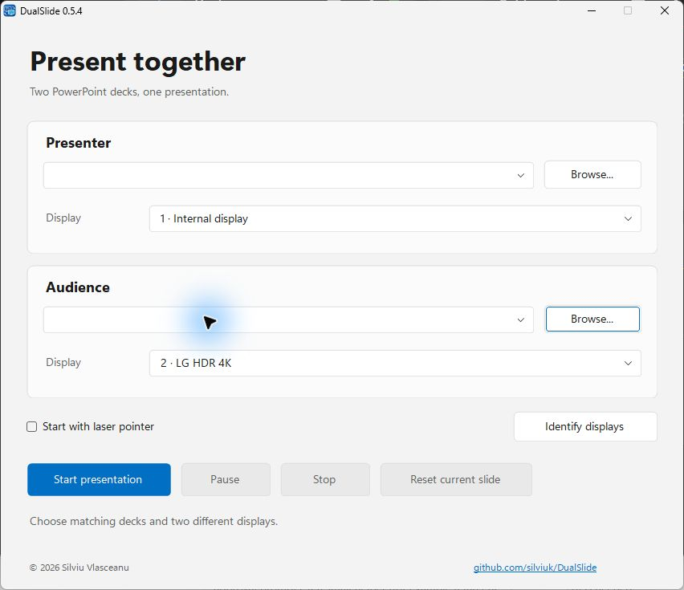

[**Website & downloads ↗**](https://silviuk.github.io/DualSlide/) · [Latest release](https://github.com/silviuk/DualSlide/releases/latest)

# DualSlide

Show two PowerPoint decks on separate screens and control both from one presentation. As you move through the presenter deck, the audience deck follows the slides, animation steps, and pointer.

**Windows 11 · Microsoft PowerPoint**

## What you can do

- **Show different slides to each screen.** Use one deck for each screen—for example, two language versions of the same talk. PowerPoint runs both slideshows.
- **Animations and pointers follow along.** Use your usual clicks, keys, and mouse wheel. The other deck follows ordinary animation steps and your cursor or laser pointer.
- **Choose your decks and screens.** Use Identify displays to find the right screens. DualSlide remembers paired decks for next time. During a talk, you can pause, reset the current slide, or press Escape to stop both shows.

- **Keep decks open for editing.** Enable the option before starting to reopen both app-owned presentations for editing after the slideshows end. DualSlide never saves them.

## Screenshot

*Captured from DualSlide 0.5.4 on Windows 11, 25 October 2026.*

## Get started

1. Download the latest ZIP from Releases, extract it, and open DualSlide.exe.
2. Choose two matching decks and a different display for each. Use Windows Extend mode.
3. Select Start and present as usual. Press Escape to end both shows.

DualSlide opens your presentations read-only and doesn’t make copies. When you stop, it closes the decks it opened without saving. Enable **Keep presentations open for editing after slideshow** to release write protection and reopen those original files normally in PowerPoint. DualSlide never saves your edits; saving is your choice. This setting is off by default and remembered. Read-only decks that were already open stay open in their existing mode, preserving unsaved edits.

## Before you start

Windows 11 x64, desktop Microsoft PowerPoint installed and configured, and two displays in Extend mode. The decks need matching slide counts, aspect ratios, and ordinary animation sequences. PowerPoint for the web is not supported.

DualSlide follows PowerPoint’s slide and animation state, so the two shows won’t be perfectly frame-synchronized. Shape-specific triggers, ink, and synchronized audio or video aren’t supported. Close any editable PowerPoint sessions using these files before starting.

## More information

See the [user guide](USER_GUIDE.md), [development guide](docs/DEVELOPMENT.md), and [interactive verification guide](VERIFICATION.md).

Something not working, or have a suggestion? [Open an issue](https://github.com/silviuk/DualSlide/issues). If you’d like to support my work, [you can leave a tip on Ko-fi](https://ko-fi.com/silviuvlasceanu).

© 2026 Silviu Vlasceanu.
