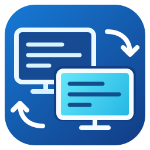

# DualSlide



DualSlide is a small Windows app that presents two matching PowerPoint decks on separate displays. Control the presenter deck normally while the audience deck follows its slides, animation steps, and pointer movements. Use it for translated presentations, presenter-only notes in a parallel deck, or any pair of presentations that share the same structure.

PowerPoint renders both slideshows and their animations. DualSlide controls two native slideshow windows in one PowerPoint application; it does not convert slides or implement a presentation renderer.

## Features

- Synchronizes ordinary clicks, keyboard navigation, mouse-wheel navigation, and animation steps, including Appear effects.
- Mirrors the presenter's native cursor shape and hotspot, with a PowerPoint-style ring and halo in laser mode.
- Supports separate display scaling settings and fits each slideshow to its selected screen.
- Uses Windows display names, with an Identify displays button and automatic prevention of duplicate display selections.
- Remembers recent presentations and their paired decks in either selection direction.
- Adapts to Windows light/dark mode and accent color.
- Provides Pause, Stop, and Reset current slide controls. Escape or ending either slideshow stops the paired session.
- Opens original presentations read-only, holds write-denying file handles, and closes app-owned decks without saving or prompting. Quits PowerPoint when DualSlide started it and no presentations remain. No presentation copies are created.
- Runs one controller per Windows session and includes a recovery watchdog for stalled PowerPoint calls.

## Requirements

- Windows 11 on an x64 PC.
- Microsoft PowerPoint desktop installed and configured; PowerPoint for the web is not supported.
- Two displays in Windows **Extend** mode.
- Two presentations with matching slide counts, aspect ratios, and ordinary animation sequences.

## Download and use

1. Download `DualSlide-0.5.3.zip` from [Releases](https://github.com/silviuk/DualSlide/releases/latest).
2. Extract the ZIP and run `DualSlide.exe`. No installer or .NET SDK download is needed.
3. Select the presenter and audience decks, then choose a different display for each. Use **Identify displays** if needed.
4. Optionally enable **Start with laser pointer**, then select **Start**.
5. Operate the presenter slideshow as usual. Press **Escape** to end both shows.

Close any editable PowerPoint session using these files before starting. Existing read-only decks can be reused; DualSlide leaves borrowed decks open and preserves their existing unsaved edits when the session ends.

Settings and paired file history are stored under `%LOCALAPPDATA%\DualSlide`. Diagnostics are written to `DualSlide.log` in that directory. See the [user guide](USER_GUIDE.md) for controls and troubleshooting.

## Build from source

Run these commands in PowerShell from the repository root:

```powershell
.\build.ps1
```

The executable is written to `dist/DualSlide.exe`. The build uses the Windows .NET Framework C# compiler and WPF assemblies at `%WINDIR%\Microsoft.NET\Framework64\v4.0.30319`; no NuGet restore or Office interop package is required. PowerPoint is needed to run a presentation, but not to compile the app.

To build a distributable ZIP and SHA-256 checksum:

```powershell
.\package.ps1
```

This rebuilds the executable and produces `dist/DualSlide-0.5.3.zip` and its `.sha256` file, including documentation and icon assets. The version is read from the executable metadata.

### Icon

The editable icon source is [assets/DualSlide.svg](assets/DualSlide.svg). Windows uses the derived, multi-resolution `assets/DualSlide.ico` for the executable and window. Both are committed, so normal builds need no image tools. After editing the SVG, regenerate the ICO with Node.js and the `sharp` package available:

```powershell
node tools/build-icon.cjs
```

## Automated builds and releases

[GitHub Actions](https://github.com/silviuk/DualSlide/actions) builds on pushes to `main`, pull requests, version tags, and manual dispatch. The Windows runner compiles the app, runs the animation replay regression without PowerPoint, and uploads the ZIP and checksum as workflow artifacts.

Pushing a tag such as `v0.5.3` also publishes a GitHub release with those artifacts after the build and regression pass. The workflow rejects tags that do not match the executable version. Release publishing uses the repository's `GITHUB_TOKEN`; no personal access token is required.

## Verification and limits

Run the animation replay regression without opening presentations:

```powershell
New-Item -ItemType Directory -Force .build | Out-Null
.\test-build.ps1 -Source AnimationReplayTest.cs -Main AnimationReplayTest -Output .build\AnimationReplayTest.exe
& .\.build\AnimationReplayTest.exe
if ($LASTEXITCODE -ne 0) { throw 'Animation replay regression failed' }
```

PowerPoint and two displays are required for the interactive tests documented in [VERIFICATION.md](VERIFICATION.md). `AppearVisualTest.cs` creates disposable test decks. Other session tests use a local matching pair named `test-master.pptx` and `test-follower.pptx`; local presentations and diagnostic outputs are excluded from Git.

Synchronization follows PowerPoint's slide/build state and is not frame-locked. Shape-specific animation triggers, ink mirroring, and synchronized audio/video clocks are outside scope. A hard Office or graphics-driver hang may not accept the watchdog's cancellation or minimization requests.

## Source layout

| File | Responsibility |
| --- | --- |
| `DualSlide.cs` | Setup window, PowerPoint sessions, navigation, and animation synchronization |
| `PointerRenderer.cs` | Native cursor copying, WPF laser rendering, and display mapping |
| `ModernWindows.cs` | Theme, accent color, display discovery, and identification |
| `DeckHistory.cs` | Recent presentations and paired selections |
| `SessionSafety.cs` | Single-instance handling, input hooks, recovery, and logging |

## Support the project

If DualSlide is useful to you, you can [leave a tip on Ko-fi](https://ko-fi.com/silviuvlasceanu).

Copyright (C) 2026 Silviu Vlasceanu. [GitHub project](https://github.com/silviuk/DualSlide).
